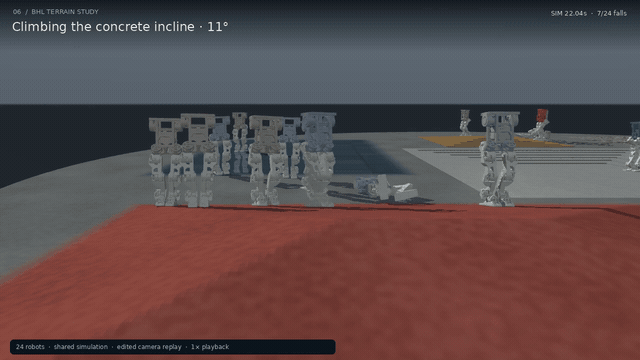
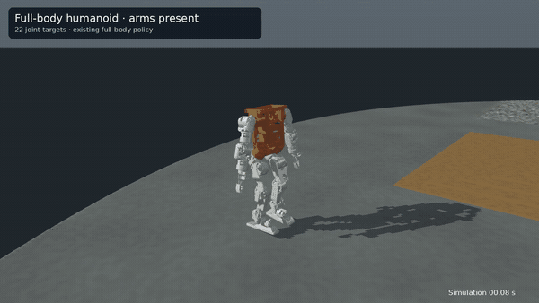
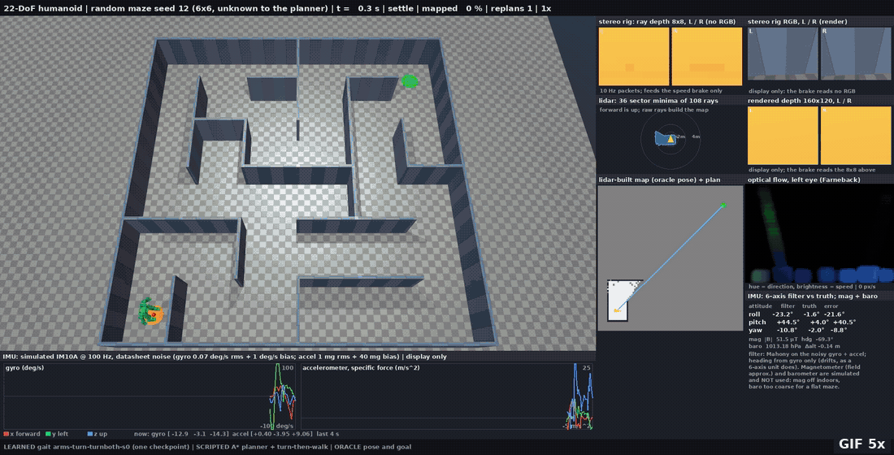
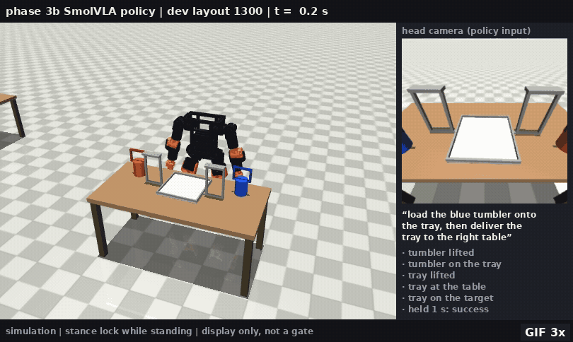
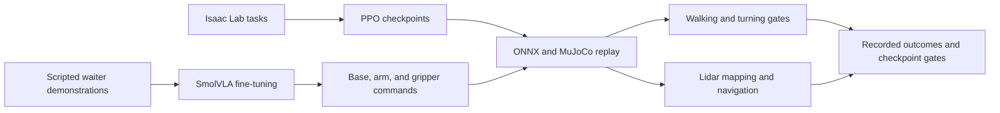

# Humanoid Simulation

Walking, navigation, and language-guided carrying with Berkeley Humanoid Lite. I build training tasks, controllers, and evaluations that make successful rollouts—and their limits—inspectable.

| Area | What it tests | Visual case study |
|---|---|---|
| [Locomotion & Control](#locomotion--control) | Walking, turning, disturbances, and terrain across Isaac Lab and MuJoCo. | [Locomotion](https://jose-sanchez-portfolio-com.vercel.app/projects/bhl-robustness-ladder/) |
| [Perception & Navigation](#perception--navigation) | Lidar mapping, planning, sensor timing, and goal-reaching above a learned gait. | [Navigation](https://jose-sanchez-portfolio-com.vercel.app/projects/humanoid-navigation/) |
| [Language-Guided Manipulation](#language-guided-manipulation) | Pick the instructed tumbler, load a tray, and carry it to the requested table. | [Manipulation](https://jose-sanchez-portfolio-com.vercel.app/projects/language-guided-manipulation/) |

**Simulation only.** Robot assets and the deployment controller originate from [Berkeley Humanoid Lite](https://github.com/HybridRobotics/Berkeley-Humanoid-Lite). My contributions include task overlays, matched evaluations, sensor integration, checkpoint gates, and the waiter policy pipeline. Each study states its learned, scripted, and oracle components.

[Selected results](#selected-results) · [Setup](#setup-and-testing) · [Demo gallery](docs/GALLERY.md) · [Research overview](docs/RESEARCH_OVERVIEW_2026-10-12.md)

## Locomotion & Control

[](https://jose-sanchez-portfolio-com.vercel.app/projects/bhl-robustness-ladder/)

*October 14 visual demonstration, real-time playback: frozen 12-DoF gait plus guarded terrain adapters; scripted routes use oracle simulated pose. The 24-robot source capture includes eight falls. This selected 11° ramp clip is separate from the scored 3° terrain study below. Stereo and lidar panels are display-only. [Media provenance](docs/gifs/humanoid-media-20261014.json).*

[](https://jose-sanchez-portfolio-com.vercel.app/projects/bhl-robustness-ladder/)

*Separate 16-second rollout using the existing upstream 22-joint full-body policy, at real time. All arm and leg targets come from that policy. It is not a new training result and does not inherit the 12-DoF benchmark scores. [Recording and audit](docs/gifs/humanoid-media-20261014.json).*

The later **R1HO** recipe qualifies all three fine-tuning seeds for turning and walking. Earlier R1/R2/R1H failures remain recorded. The new terrain films show visible dirt relief, physical gravel, and an 11° ramp; they do not establish a new reliability result. Contact-triggered footprints are a visual effect and do not deform collision geometry.

## Perception & Navigation

[](docs/RANDOM_MAZE.md)

*Selected 22-DoF maze rollout, 5× playback: learned gait, scripted A* planner, lidar-built map, oracle pose and goal. Stereo, optical-flow, and IMU panels are display-only. The reported humanoid maze study reaches 12/12 fresh layouts without falls or wall contacts. [Protocol](docs/RANDOM_MAZE.md).*

**Latest navigation audit:** the V6 budgeted-recovery controller reaches **288/288 goals**, versus **286/288** for its existing recovery reference, with zero falls in both. Clean goals decrease **282 → 276**, and contact episodes increase **5 → 12**. This is a finite-sample result on 48 shared maze layouts, three fixed navigation actors, and two sensing conditions. Model-influence counters are zero: the improvement is from scripted recovery, not a learned world model. The overall V6 campaign remains incomplete because its separate terrain confirmation fails asset matching. [Auditable outcomes and scope](docs/UPGRADE_V6_NAVIGATION_2026-10-14.md).

Estimated-pose work is a separate experiment. Native FAST-LIO2 terrain control completes its 480-episode confirmation; native stereo navigation remains limited. A later 48-episode scheduling comparison changes LiDAR–IMU clean goals **0/12 → 11/12**, while stereo remains **0/12** in both schedules. [Scientific closeout](docs/HPC_SIMULATION_CLOSEOUT_2026-10-11.md) · [Scheduling results](docs/PROCESSING_SCHEDULE_RESULTS_2026-10-12.md).

## Language-Guided Manipulation

[](docs/WAITER_PROGRAM.md)

*Phase 3b SmolVLA, one development-layout episode at 3× playback. The sentence selects the tumbler and destination. This demonstration is separate from the scored evaluation. A stance lock holds the base while standing and releases it for walking. [Clip provenance](docs/gifs/waiter-3b-task-seed1300.json).*

The 24-joint robot adds two grippers. SmolVLA turns rendered head-camera images, text, and proprioception into base-velocity, arm, and gripper commands. Retraining with more demonstrations and more early-episode samples improves object selection; the final gate scores **75/100** original instructions and **76/100** held-out phrasing.

- Demonstrations come from a scripted expert with **oracle object positions**.
- The domain has **two colours, two destination tables, and six instruction templates**; each learned result is one checkpoint from one run.
- **Standing assistance remains necessary.** The expert scores 86/100 with the stance lock and 1/100 with a free base. The latest 1h controller selects no qualified seed.
- DSRL on phase 3b fails its improvement gate: **80/100 versus 74/100**, p = 0.20; constant zero noise scores 82/100.

[Program and results](docs/WAITER_PROGRAM.md) · [Task/control interfaces](docs/WAITER_INTERFACES.md) · [Latest standing-controller verdict](results/waiter-20261005/wbc1h/selection.json)

## Selected results

Verified against retained evidence on **October 14, 2026**. Different rows describe separate experiments and robot variants; the new GIFs are demonstrations.

| Study | Measured result | Scope and evidence |
|---|---|---|
| Domain randomization | Default: **0/360 flat falls**; no randomization: **77/360**. | 12-DoF biped, three training seeds per setting; part of a 3,600-episode confirmation. [Verdict](campaigns/20261006-confirmatory/results/dr_verdict.json). |
| R1HO turning and walking | **3/3** qualified seeds; **30/30** turns, **9/9** walks; push falls **8/60, 9/60, 8/60**. | 22-DoF simulation, simulator yaw, three fine-tunes of one parent on existing benchmark cases. [Independent summary](results/h34-campaign-20261008/h4/finalization/collection/scientific-summary.json). |
| Native-pose terrain confirmation | Heading pursuit: **180/180 clean goals versus 19/180** baseline. | Within 480 held-out trials; three frozen 12-DoF actors, flat / 1 cm steps / 3° ramps, FAST-LIO2 estimated pose. [Protocol and limits](docs/TERRAIN_CONFIRMATION_2026-10-11.md). |
| Navigation recovery, V6 | **288/288 goals versus 286/288** reference; zero falls in both. | 1,152 trials across four methods; 48 layout clusters; oracle pose/goal. Clean goals 276 versus 282 reference; scripted recovery, no world-model influence. [Outcome audit](docs/UPGRADE_V6_NAVIGATION_2026-10-14.md). |
| Language-guided carrying | **75/100** original instructions; **76/100** held-out phrasing. | SmolVLA phase 3b; unseen layouts, stance lock, rendered vision, small instruction domain. [Verdict](results/waiter-20261005/phase3b-gate/verdict.json). |
| Portable replay | **5/5** seeded trajectories reproduced on a second HPC host. | Frozen CPU bundle/runtime; not general cross-platform determinism. [Comparison](results/task-closure-20261008/h2-replay/cross-host.json). |

The earlier [H1 navigation filter confirmation](docs/H1_NAVIGATION_CONFIRMATION_2026-10-08.md) retains **259/288 versus 247/288** goals and **0 versus 9** falls. The matched [IMU-history ablation](docs/H3_H4_CAMPAIGN_2026-10-08.md) remains negative. Native sensor failures and the [retracted ice-hazard claim](docs/FINDINGS.md) remain published. None of these results validates physical locomotion transfer.

## How it works



| Code | Responsibility |
|---|---|
| [Task overlays](src/bhl_robust/tasks/) | Observations, rewards, and curricula. |
| [Evaluation](src/bhl_robust/eval/) | MuJoCo replay, sensing, task environments, and scoring. |
| [Navigation environment](src/bhl_robust/navgym/) | Learned navigation interface and training environment. |
| [Waiter pipeline](scripts/waiter/) | Demonstrations, VLA training, controller selection, and task gates. |
| [Benchmark scripts](scripts/bench/) | Matched comparisons and frozen checkpoint gates. |
| [Results](results/) | Scores, provenance, negative findings, and recordings. |

## Engineering decisions

- **Promote on task outcomes.** Reward alone misses falls, wall contacts, and failed goals; frozen rules determine acceptance.
- **Declare the controller's inputs.** Learned gait, scripted planning, oracle state, and standing assistance are identified per study.
- **Retain controls and failures.** The failed DSRL gate, standing-controller failures, and stereo limitations prevent favorable clips from becoming unsupported claims.
- **Keep replay portable.** A pinned CPU bundle includes the checkpoint, controller, assets, and hashes; timing claims retain their stated runtime scope.

## Setup and testing

The CPU suite uses Python 3.11. Training additionally needs the documented Isaac environment, GPU resources, and cluster configuration. Some historical results reference external assets that are not public downloads; see [reproducibility requirements](docs/REPRODUCIBILITY.md).

```bash
git -c url.https://github.com/.insteadOf=git@github.com: clone \
  --recurse-submodules https://github.com/joses2017smjh/bhl-robustness-ladder.git
cd bhl-robustness-ladder
python3.11 -m venv .venv-cpu
source .venv-cpu/bin/activate
python -m pip install torch==2.7.0 torchvision==0.22.0 \
  --index-url https://download.pytorch.org/whl/cpu
python -m pip install -r requirements-test.txt
python -m pip check
OMP_NUM_THREADS=1 OPENBLAS_NUM_THREADS=1 MKL_NUM_THREADS=1 \
  PYTHONPATH=src:external/Berkeley-Humanoid-Lite/source/berkeley_humanoid_lite_lowlevel \
  python -m pytest -q tests
```

The [CPU workflow](.github/workflows/cpu-replay.yml) also installs frozen-bundle requirements and runs trained-asset integration and seeded replay. Tests cover logic and artifact contracts; simulator and asset prerequisites cause documented optional skips. The saved [October 8 validation receipt](results/task-closure-20261008/h2-replay/local-validation.json) records 1,998 tests plus six subtests passing, with 123 skips. That receipt is historical, not a new full-suite run.

For a frozen trained-policy replay, start with the included [portable bundle](results/resume-revamp-20261007/portable-bundle.zip) and its `USAGE.txt`. [Bundle provenance, timing scope, and detailed instructions](docs/RESEARCH_OVERVIEW_2026-10-12.md#portable-simulation-regression-replay).

## Training and deployment

[Slurm launchers](slurm/) describe the original Isaac Sim 5.1 / Isaac Lab 2.3.2 stack; newer campaigns use a separate 6.0 / 3.0 environment. Adapt account, partition, dependencies, and paths before submitting jobs. The [research overview](docs/RESEARCH_OVERVIEW_2026-10-12.md) retains the full setup and campaign history.

Physical [Quest arm teleoperation](https://github.com/joses2017smjh/quest-vr-teleop) is a separate project. The [sensor rig plan](docs/HARDWARE_RIG_C1_STEREO_YAHBOOM_2026-10-11.md) describes pending calibration and hardware validation. [Repository boundaries and transfer milestones](docs/PROJECT_BOUNDARIES.md) explain the proposed next step.

## Stack and attribution

Python · PyTorch · Isaac Lab / Isaac Sim · MuJoCo · SmolVLA · ONNX Runtime · Warp · rsl-rl · Slurm · Apptainer.

Upstream robot code, models, and assets retain their respective licenses. This repository currently has no repository-level license.

[Portfolio](https://jose-sanchez-portfolio-com.vercel.app/) · [Detailed research overview](docs/RESEARCH_OVERVIEW_2026-10-12.md) · [Findings ledger](docs/FINDINGS.md)
