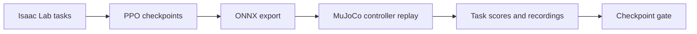

# Humanoid Locomotion & Navigation

Train humanoid policies in Isaac Lab, then measure how they walk, turn, and navigate in MuJoCo. **Humanoid Robustness Ladder** combines learned control with reproducible evaluations and sensor studies.

[](docs/RANDOM_MAZE.md)

*Selected MuJoCo rollout: learned gait, scripted A* planner, lidar-built map, and oracle pose/goal. Other sensor panels are display only. Playback is accelerated. This is simulation-to-simulation; physical locomotion transfer remains unvalidated.*

[Case study](https://jose-sanchez-portfolio-com.vercel.app/projects/bhl-robustness-ladder/) · [Results](#selected-results) · [Setup](#setup-and-testing) · [Demo gallery](docs/GALLERY.md) · [Research overview](docs/RESEARCH_OVERVIEW_2026-10-12.md)

## Problem and contribution

A policy can earn more training reward and still fall in another simulator. I built task overlays, checkpoint qualification, sensor checks, and experiment drivers to measure that gap before promoting a policy.

The robot design and deployment controller come from [Berkeley Humanoid Lite](https://github.com/HybridRobotics/Berkeley-Humanoid-Lite). My work adds locomotion and navigation experiments, MuJoCo scoring, portable regression replay, and published controls and failures.

## Selected results

These are saved study results, not new measurements from this documentation refresh.

| Study | Measured result | Scope and evidence |
|---|---|---|
| Domain randomization | Default: **0/360 flat falls**; no randomization: **77/360**. | 12-DoF biped, three training seeds per setting, part of a 3,600-episode simulation confirmation. [Verdict](campaigns/20261006-confirmatory/results/dr_verdict.json). |
| Navigation command filter | **259/288 goals** versus **247/288** baseline; **0 versus 9** observed falls. | 576 matched episodes across three actors; oracle pose/goal. Shared layouts are clustered observations; wall contacts remain. [Protocol and results](docs/H1_NAVIGATION_CONFIRMATION_2026-10-08.md). |
| Portable replay | **5/5** seeded trajectories reproduced on a second HPC host. | Frozen CPU bundle and runtime; no claim of general cross-platform determinism. [Comparison](results/task-closure-20261008/h2-replay/cross-host.json). |

Negative findings remain part of the project: the matched IMU-history ablation did not qualify, and stereo-pose navigation remained limited. [H3/H4 report](docs/H3_H4_CAMPAIGN_2026-10-08.md) · [Native sensor report](docs/NATIVE_CAMPAIGN_RESULTS_2026-10-09.md).

October 12 follow-ups: [48 native scheduling simulations completed](docs/PROCESSING_SCHEDULE_RESULTS_2026-10-12.md), with LiDAR–IMU clean goals **0/12 → 11/12** and stereo **0/12 in both schedules**. [EuRoC replay completed](docs/EUROC_NATIVE_REPLAY_RESULTS_2026-10-12.md) on **1,200 stereo pairs per native mode**. Both reports retain timing, order and validation limits.

## How it works



| Code | Responsibility |
|---|---|
| [Task overlays](src/bhl_robust/tasks/) | Observations, rewards, and curricula. |
| [Evaluation](src/bhl_robust/eval/) | MuJoCo replay, sensing, and scoring. |
| [Benchmark scripts](scripts/bench/) | Matched comparisons and checkpoint gates. |
| [Slurm launchers](slurm/) | Training and evaluation jobs on the research cluster. |
| [Results](results/) | Saved scores, provenance, and recordings. |

## Engineering decisions

- **Gate checkpoints on task outcomes.** Reward alone misses falls, wall contacts, and failed goals. Frozen rules keep favorable runs from changing the acceptance criteria.
- **Separate learned control from supervision.** A learned gait can sit under a scripted planner or a learned navigator. Each report states its controller, sensors, and use of oracle state.
- **Keep replay portable.** A pinned CPU bundle includes the checkpoint, controller, assets, and hashes. Timing claims exclude physics, networking, and real-time scheduling.
- **Treat sensor accuracy and navigation success separately.** Better depth on an image benchmark does not by itself establish better closed-loop control.

## Setup and testing

The CPU suite uses Python 3.11. Training additionally needs the documented Isaac environment, GPU resources, and cluster configuration. Some historical results reference external assets that are not public downloads; see [reproducibility requirements](docs/REPRODUCIBILITY.md).

```bash
git -c url.https://github.com/.insteadOf=git@github.com: clone \
  --recurse-submodules https://github.com/joses2017smjh/bhl-robustness-ladder.git
cd bhl-robustness-ladder
python3.11 -m venv .venv-cpu
source .venv-cpu/bin/activate
python -m pip install torch==2.7.0 torchvision==0.22.0 \
  --index-url https://download.pytorch.org/whl/cpu
python -m pip install -r requirements-test.txt
python -m pip check
OMP_NUM_THREADS=1 OPENBLAS_NUM_THREADS=1 MKL_NUM_THREADS=1 \
  PYTHONPATH=src:external/Berkeley-Humanoid-Lite/source/berkeley_humanoid_lite_lowlevel \
  python -m pytest -q tests
```

These commands match the [CPU workflow](.github/workflows/cpu-replay.yml). Tests cover logic and artifact contracts; simulator and asset prerequisites cause documented optional skips. The saved [October 8 validation receipt](results/task-closure-20261008/h2-replay/local-validation.json) records 1,998 tests plus six subtests passing, with 123 skips. That receipt is historical, not a new full-suite run.

For a frozen trained-policy replay, start with the included [portable bundle](results/resume-revamp-20261007/portable-bundle.zip) and its `USAGE.txt`. [Bundle provenance, timing scope, and detailed instructions](docs/RESEARCH_OVERVIEW_2026-10-12.md#portable-simulation-regression-replay).

## Training and deployment

[Slurm launchers](slurm/) describe the original Isaac Sim 5.1 / Isaac Lab 2.3.2 stack; newer campaigns use a separate 6.0 / 3.0 environment. Adapt account, partition, dependencies, and paths before submitting jobs. The [research overview](docs/RESEARCH_OVERVIEW_2026-10-12.md) retains the full setup and campaign history.

Physical [Quest arm teleoperation](https://github.com/joses2017smjh/quest-vr-teleop) is a separate project. The [sensor rig plan](docs/HARDWARE_RIG_C1_STEREO_YAHBOOM_2026-10-11.md) describes pending calibration and hardware validation. [Repository boundaries and transfer milestones](docs/PROJECT_BOUNDARIES.md) explain the proposed next step.

## Stack and attribution

Python · PyTorch · Isaac Lab / Isaac Sim · MuJoCo · ONNX Runtime · Warp · rsl-rl · Slurm · Apptainer.

Upstream robot code, models, and assets retain their respective licenses. This repository currently has no repository-level license.

[Portfolio](https://jose-sanchez-portfolio-com.vercel.app/) · [Detailed research overview](docs/RESEARCH_OVERVIEW_2026-10-12.md) · [Findings ledger](docs/FINDINGS.md)
