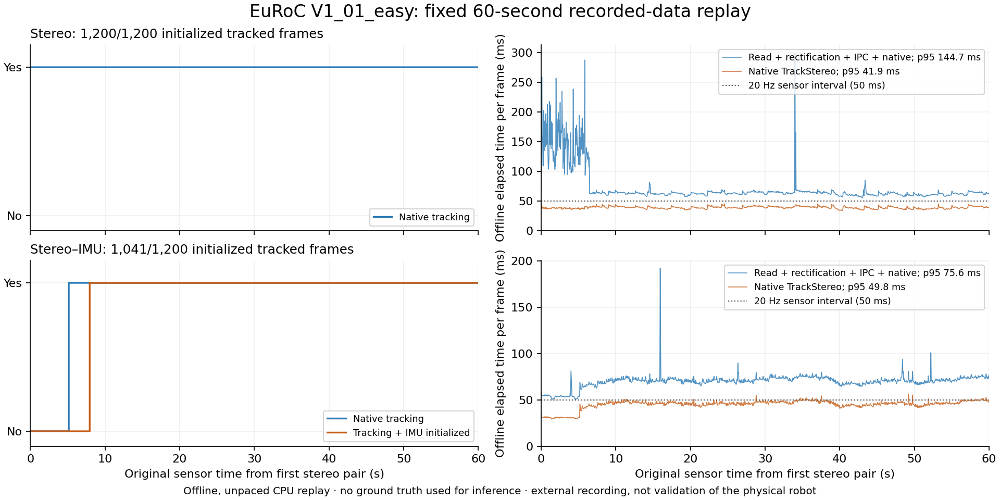

# EuRoC V1_01_easy: recorded-data replay completed

**October 14 accuracy update:** [ATE is now
measured](EUROC_POSE_ACCURACY_2026-10-14.md) on the same 60-second, 1,200-pair
segment. Stereo reaches 0.020 m ATE RMSE against the recomputed reference (0.036
m against the original). The stereo–IMU output jumps 0.8 m at 20.6 s, which
tracking coverage alone did not show. The "Unmeasured" entries below record the
state on October 12.

Both predeclared native arms completed **1,200/1,200 original stereo pairs**
from the first 60 seconds of EuRoC V1_01_easy. **Stereo tracked 1,200/1,200
frames; stereo–IMU tracked 1,097/1,200, including 1,041 frames after native IMU
initialization.** Both retained one continuous coordinate epoch and no tracking
loss after tracking began. These are external recorded-sensor results, not
simulation or validation of the user's robot.

The [complete native result](../results/euroc-native-replay-20261012/full/native/result.json)
and [independent trace check](../results/euroc-native-replay-20261012/independent-verification.json)
retain every frame, the initialization prefix, timing outliers and all native
states. No sequence, window, native parameter or runtime was changed after
observing estimator outcomes.

| Measure, fixed 1,200-frame denominator | Native stereo | Native stereo–IMU |
| --- | ---: | ---: |
| Frames processed | 1,200 | 1,200 |
| Native tracked frames | 1,200 (100%) | 1,097 (91.42%) |
| Initialized tracked frames | 1,200 (100%) | 1,041 (86.75%) |
| First initialized tracked sensor time | 0.00 s | 7.95 s |
| Tracking-loss transitions after tracking began | 0 | 0 |
| Continuous native coordinate epochs | 1 | 1 |
| Native `TrackStereo` compute, p95 | 41.93 ms | 49.80 ms |
| Entire measured frame pipeline, p95 | 144.75 ms | 75.58 ms |
| ATE / pose accuracy | Unmeasured | Unmeasured |

[Export the figure as SVG](../results/euroc-native-replay-20261012/euroc-tracking-latency.svg).
The measured pipeline includes original image reads, fixed rectification, PNG
writes, IPC and native processing. Startup, one-time rectification-map
construction and diagnostic JSON writes are excluded and separately accounted
for. This was offline, unpaced replay; the 20 Hz sensor rate does not establish
20 Hz end-to-end operation. Arms ran in fixed order, stereo first. The larger
early stereo I/O times remain in the result; cache state and arm order were not
controlled, so lower stereo–IMU pipeline p95 is **not evidence that adding IMU
made the implementation faster**.

## Access and data identity

A fresh request to the official ETH bitstream returned HTTP 429 at 11:54 PDT,
October 12, without a Retry-After header. Requests to that host stopped. A
bounded legacy ETH request timed out. The exact sequence was then acquired
from the public [V1_01_easy mirror](https://huggingface.co/datasets/pepijn223/euroc-mirror/tree/d05bd6a92a5f456562153f83d65805fea27cb57d),
pinned to revision `d05bd6a92a5f456562153f83d65805fea27cb57d`.

The downloaded archive was **1,149,702,102 bytes**, matching its published LFS
SHA256 `a920fe5b5e69a6ad19b32f1cfaf90ac2f59d45dfd1ca18cc9722e07684ba45fa`.
Safe extraction checked all 5,856 archive members, including ZIP CRCs, duplicate
paths, traversal, and symlinks. The archive and expanded contents total
**3,382,238,084 bytes (3.15 GiB)**, below the authorized 12 GiB supplement limit.
No original imagery, sensor CSV or point cloud is published here.

All **2,912** timestamps in each camera stream match the
[upstream ORB-SLAM3 V101 sequence list](https://github.com/UZ-SLAMLab/ORB_SLAM3/blob/4452a3c4ab75b1cde34e5505a36ec3f9edcdc4c4/Examples/Stereo/EuRoC_TimeStamps/V101.txt)
exactly. Both cameras' intrinsics/distortion and stereo extrinsics independently
match the pinned upstream calibration. These establish sequence/metadata
consistency and mirror-byte integrity. **Full image-byte identity to the
inaccessible ETH master archive remains unverified.**
[Intake receipt](../results/euroc-native-replay-20261012/intake.json),
[reference checks](../results/euroc-native-replay-20261012/reference-identity.json),
and [access receipts](../results/euroc-native-replay-20261012/).

The [ETH dataset page](https://projects.asl.ethz.ch/datasets/euroc-mav/)
identifies the original authors and distribution. The recorded rights statement
is In Copyright – Non-Commercial Use Permitted; this repository publishes our
own derived outputs and integrity receipts.

## Frozen execution and verification

The [original protocol](../results/euroc-external-validation-20261011/protocol.json)
remains unchanged: earliest exact stereo pair through less than 60 seconds,
at most 1,200 pairs, original nanosecond clock, original genuine causal IMU,
no tuning, and both native arms. The selected last timestamp is 59.950000128 s.
The stereo–IMU arm acknowledged **11,991** measured IMU rows without future,
repeated, synthetic or interpolated samples.

The scientific source was frozen from commit
`1e973fbcfa582849150bc1c0116c25184ba4a77c`; source archive SHA256 is
`3a6dbfe33afe4871df1e7ef1d2ecb6fcd77c6c9bd2cab30a86f81bcdafca5beb`.
Both native arms use runtime SHA256
`91ca4b6e4ea8f318998f400d4f7dfcd6fe8ae88b375399c79d5d633c39d71516`.
The shared replay adapter was already software-tested; no native scientific
code change was needed to run these recordings.

| Slurm job | Purpose | Terminal state |
| --- | --- | --- |
| 21801765 | Fresh 40-pair execution smoke in each arm | COMPLETED, 0:0; 1m02s |
| 21801792 | Full 1,200-pair replay in each arm | COMPLETED, 0:0; 3m25s |
| 21801837 | Independent trace verification and figure | COMPLETED, 0:0; 4s |

The execution smoke processed 40/40 pairs in both modes. Stereo–IMU did not
initialize within this 1.95-second smoke; that observation was retained. The
predeclared gate checked execution and identity rather than selecting successful
estimator outcomes. Only after the smoke verified did the full replay launch
on the same four-CPU, 8 GiB compute node inside the existing container.

Source and sensor inputs were mounted read-only with private node-local
home/cache/runtime directories. Only the camera/IMU files in the selected-input
manifest were staged for inference; ground-truth files were not mounted.
Original inputs were hashed before and after execution. Native outputs were
checked against all 1,200 original timestamps per arm, the source/protocol/
runtime/smoke identities, every compact-file manifest, tracking and epoch counts,
IMU causality and independently recomputed latency statistics.
[Execution plan](../results/euroc-native-replay-20261012/launch-plan.json),
[smoke verification](../results/euroc-native-replay-20261012/smoke-verification.json),
and [Slurm accounting](../results/euroc-native-replay-20261012/slurm-accounting.json).

## Scientific limits and useful next work

Tracking coverage is not pose accuracy. ATE remains explicitly unmeasured:
[OpenVINS documents an orientation issue in the original V1_01_easy reference](https://github.com/rpng/open_vins/blob/master/docs/gs-datasets.dox)
and provides a separately recomputed IMU reference. Neither a corrected-reference
choice nor a separate EuRoC pose-accuracy evaluator was validated in this replay.
The initial IMU delay, single recording, single execution, fixed arm order and
lack of controlled cache state prevent broad estimator rankings.

The relevant simulation follow-up is the separate 48-episode camera scheduling
comparison: native processing time and complete pipeline latency need separate
measurements. This recorded-data result supports testing image/transport
overhead and initialization-aware supervision; it does not demonstrate that a
particular scheduler improves closed-loop navigation. Calibration, pan/tilt
extrinsics, synchronization and physical rig validation still require the
user's robot or recordings.

A supported résumé bullet is:

> Built and verified a reproducible native stereo/IMU replay pipeline over 2,400
> EuRoC frame observations, preserving causal sensor timing and provenance;
> stereo maintained 100% tracking over the fixed 60-second window with zero
> observed map discontinuities, while profiling native and complete pipeline latency separately.

Do not convert this into a metric-accuracy, real-time, hardware-deployment or
sensor-fusion superiority claim.
