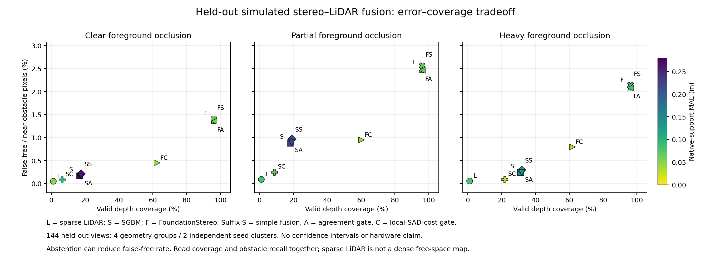
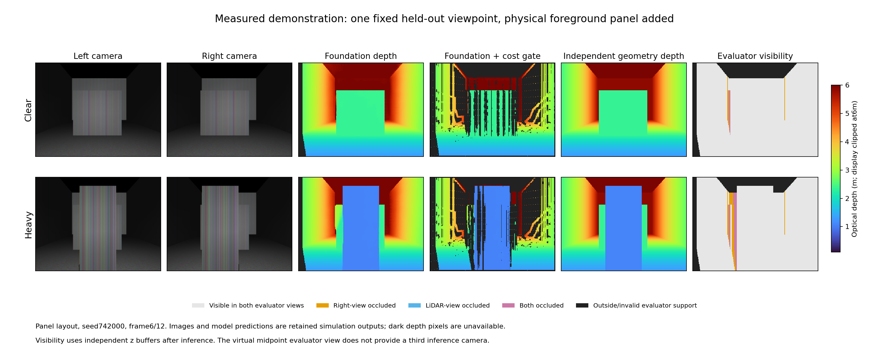

# Controlled geometric occlusion and stereo–LiDAR fusion

Completed: GPU job `21768578` finished all **30 cells / 300 stereo pairs** in 9m20s: 12 smoke, 144 development and 144 held-out pairs. Publisher `21768579` completed and independently downloaded the published raw archive to verify its SHA256. A separate CPU process downloaded that archive again and recomputed every frame's visibility and nine-arm native/common/pairwise/stratum metrics; all three complete collections matched exactly. The 16 focused CPU tests also passed.

The cost gate reduced false-free pixel predictions but rejected many useful depth estimates. This is a measured accuracy–coverage tradeoff, with no overall navigation or safety improvement established.

## Measured held-out results

Each condition contains 48 correlated viewpoints from four geometry groups and **two independent seed clusters**. The table pools pixels within the heavy foreground condition. Its near-obstacle denominator is **1,524,678 pixels** for every row. Native MAE uses each arm's valid pixels, so its support differs across arms. Latency is the median of four cell p95 values, using the component-composed timing defined below.

| Arm | Native MAE (m) | Coverage | False-free pixels | Obstacle-pixel recall | Median cell p95 (ms) |
|---|---:|---:|---:|---:|---:|
| Sparse LiDAR | 0.07810 | 1.042% | 860 (0.056%) | 1.103% | 1.16 |
| SGBM | 0.13155 | 31.279% | 3,620 (0.237%) | 61.853% | 32.73 |
| SGBM + simple fusion | 0.12980 | 31.920% | 4,431 (0.291%) | 62.136% | 34.51 |
| SGBM + agreement gate | 0.12852 | 31.881% | 3,701 (0.243%) | 62.135% | 34.68 |
| SGBM + local-cost gate | 0.02755 | 21.971% | 1,247 (0.082%) | 47.876% | 38.60 |
| FoundationStereo | 0.07909 | 96.120% | 31,973 (2.097%) | 91.823% | 102.78 |
| Foundation + simple fusion | 0.07915 | 96.153% | 32,699 (2.145%) | 91.827% | 104.63 |
| Foundation + agreement gate | 0.07868 | 96.096% | 31,811 (2.086%) | 91.820% | 104.80 |
| Foundation + local-cost gate | 0.03795 | 61.784% | 12,145 (0.797%) | 69.970% | 109.26 |

Against FoundationStereo alone, the local-cost arm reduced heavy-condition false-free pixels by **62.0%**, while coverage fell **34.34 percentage points** and recall fell **21.85 points**. Missed obstacle pixels increased from **124,670 to 457,857**; unknown obstacle pixels increased from **87,697 to 444,429**. The native MAE reduction largely reflects selective rejection: on their **2,129,330 shared valid pixels**, baseline and fusion MAE were **0.038247 m and 0.037960 m**, only a 0.287 mm change. All-nine-arm common support contained just **12,400 pixels**, illustrating why that sparse intersection cannot represent dense scene accuracy.

The same tradeoff appears in the clear and partial conditions: the Foundation local-cost arm reduced false-free rates from 1.371% to 0.447%, and 2.484% to 0.951%, respectively, while reducing coverage and recall. The simpler agreement gate retained approximately 96% coverage but changed these pixel error rates only slightly. No significance test or generalization claim is supported by two seed clusters.



This fixed demonstration shows the first held-out panel seed at frame index 6 of 12, with and without the added foreground panel. The dark gaps in the gated depth expose the lost support directly; the rendered geometry changes the actual camera visibility.



[Plot data and exact denominators](../results/fusion-occlusion-20261011/figures/heldout-plot-data.json), [all held-out common-support and visibility-stratum results](../results/fusion-occlusion-20261011/figures/test-independent-collection.json), [independent verification receipt](../results/fusion-occlusion-20261011/figures/verification-receipt.json), and [reproduction script](../scripts/bench/fusion_occlusion_report.py) accompany the figures. Both figures also have editable SVG versions in the same results directory. The [published raw archive](https://github.com/joses2017smjh/bhl-robustness-ladder/releases/download/research-campaign-evidence-20261011/fusion-occlusion-20261011-21768578.tar.gz) is 383,729,889 bytes, SHA256 `a571b6298760128ed2165edf7b342fd1e621cf80d345eaa4b85f679757fa1eef`.

A supported resume statement is: “Built a reproducible nine-arm stereo–LiDAR benchmark with geometric occlusion controls; evaluated 288 scored simulated stereo pairs and quantified false-free/coverage/recall tradeoffs with independently reverified raw evidence.” Any numerical error reduction should retain the paired coverage and recall losses above.

The previous local-SAD consistency experiment reduced false-free predictions while losing coverage and obstacle recall. This follow-up tests whether that tradeoff changes when the sensors actually see different surfaces. It creates foreground geometry in MuJoCo, renders both physical camera viewpoints, and casts sparse LiDAR rays from the calibrated midpoint. It changes no image masks to manufacture occlusion.

## Frozen design

The authoritative design is [protocols/fusion_occlusion_20261011.json](../protocols/fusion_occlusion_20261011.json). `freeze` binds that design, all scientific Python sources, and the original pretrained model by SHA256 before execution.

| Cohort | Geometry groups | Conditions | Viewpoints | Frames |
|---|---:|---:|---:|---:|
| Smoke | 2 layouts × seed 740000 | Clear, partial, heavy | 2 | 12 |
| Development | 2 layouts × seeds 741000–741001 | Same three | 12 | 144 |
| Held out | 2 layouts × seeds 742000–742001 | Same three | 12 | 144 |

Layouts contain a background panel or staggered narrow posts. A real foreground box has half-width 0, 0.08 or 0.24 m. Each geometry seed fixes target displacement and texture; all three conditions share them. Viewpoints are predetermined linear offsets from x=0 to 0.2 m and y=−0.12 to 0.12 m. The rig is stationary for each acquisition. LiDAR has 16 rings × 128 azimuths and instantaneous acquisition. This removes scan-motion and deskew confounds; it does not test a walking robot.

Original images are 320×240. FoundationStereo pads to 320×256, and measured model latency includes this padding. Camera baseline is 0.12 m. The experiment uses the already pinned official C-Fast-FoundationStereo checkpoint (`2c79bbb274dc0aef687a8732b987077e9e3aa26ff9dd653141cda48c57dad5d3`); actual CUDA execution must be proven by its existing operator-profile check.

Nine arms receive the same RGB pair, raw LiDAR and calibration:

1. Sparse LiDAR alone.
2. SGBM alone, with its existing bidirectional consistency/uniqueness validity.
3. FoundationStereo alone, with its exported left-disparity validity.
4. Simple projected fusion for each stereo engine.
5. Agreement-gated fusion for each engine.
6. Local-SAD-cost plus agreement-gated fusion for each engine.

Agreement rejects dual-support differences exceeding max(0.15 m, 5% of nearer depth). Local cost reuses the existing 5×5 image SAD margin versus ±2 disparity pixels, minimum margin 0.10 and maximum mean SAD 20. It caps stereo weight at one half on agreeing support. These are engineering scores, not calibrated probabilities. Single-left-disparity FoundationStereo has no exported right-disparity consistency mask; that distinction remains visible in native-support coverage.

## Independent visibility and evaluation

All inference arms finish before evaluator depth or segmentation is rendered. The evaluator projects each left-view geometry point into independently rendered right-camera and midpoint-camera depth buffers. A nearer surface by more than 0.03 m marks the point occluded; out-of-view or invalid evaluator support remains separate. Midpoint-camera visibility describes the continuous LiDAR viewpoint; sparse ray sampling is an additional limitation. Nearest-pixel projection and depth-buffer discretization can affect boundary labels.

Retain every frame's inputs, predictions, support, cost scores, conflicts, evaluator depths and masks. Independent collection checks exact file inventories, hashes, frame identities, checkpoint/CUDA provenance and recomputes visibility plus all metrics. A smoke must exercise geometric occlusion in every nonclear cell. No development or held-out cell can start without a passing collection for all six same-source smoke cells.

Report native and all-arm-common support MAE with pixel denominators. All-arm common support can be tiny because of sparse LiDAR; report pairwise-common support for every fusion arm versus its stereo baseline, sparse LiDAR, simple fusion and agreement gate. Report visible/occluded strata separately. Keep coverage, missed obstacle pixels, unknown obstacle pixels, false-free obstacle pixels and obstacle-pixel recall alongside every accuracy comparison. “Missed” means no prediction within ±0.15 m of a true visible obstacle at ≤3 m. These are pixel proxies, not object detection or collision rates.

Timing measures real shared processing components and required PNG/NPZ decoding, summed according to each arm's dependencies. Report p95 per geometry cell plus cold model initialization. One same-input pipeline warm-up is excluded. Capture, output serialization and evaluator work are separately excluded. These are component-composed timings, not independent live-sensor deadline measurements. The 12 views within each geometry group are correlated; never count them as independent statistical trials. The two layouts share their RNG seed values and random draws. The held-out cohort therefore contains four geometry groups but only two independent seed clusters; results are descriptive and conditional on these fixed layout families. No significance or bootstrap interval is claimed.

## Execution and storage

The frozen serial entrypoint runs all six smoke cells on an allocated EGL GPU, independently collects them, and proceeds to the 24 scored cells only after that gate passes. A negative smoke writes a retained negative result with zero scored cells. The H34 launcher isolates the source, inputs, runtime and caches. A separate host publisher verifies completion/source/artifact pins and fresh-download SHA256 before publishing raw evidence. Output must be under `/nfs/hpc/share/sanchej7/humanoid-research-20261011` or allocated node-local `/tmp`, never home. Preserve ≥8 GiB of share free space. Each cell is capped at 96 MiB and the retained cohort at 2 GiB. Stop on a failed smoke or storage bound; preserve the negative receipt. No scientific parameter changes or threshold tuning are permitted after outcomes.

```bash
python scripts/bench/fusion_occlusion_campaign.py freeze \
  --output /nfs/hpc/share/sanchej7/humanoid-research-20261011/fusion-occlusion/protocol.json \
  --model /nfs/hpc/share/sanchej7/home-overflow/2026-10-11/humanoid-sensors-20261008/inputs/c_fast_foundationstereo_bp2_dynbatch_dynhw.onnx
```

`run --protocol ... --cell <exact frozen ID> --output <new directory>` produces one cell. `collect --protocol ... --phase smoke|dev|test --directories ... --output ...` validates the complete declared cohort. Scored cells also require `--smoke-receipt ...`. The completed run and fresh-download verification receipts above establish execution and complete collection; they do not establish an overall method improvement.

## Research basis and limits

[Yao, Ishikawa and Oishi (2025)](https://arxiv.org/abs/2504.05148) motivates testing cross-view consistency and sparse LiDAR support: their method combines discrete matching costs, LiDAR semidensification and consistency checks. This experiment uses a simpler local-SAD score and nearest-pixel sparse projection. It does not reproduce their aggregated SGM/discrete-cost machinery or semidensification, and their published KITTI numbers are not our results.

[Fast-FoundationStereo's official repository](https://github.com/NVlabs/Fast-FoundationStereo) provides the pretrained stereo family. Keeping its original checkpoint fixed tests a learned stereo baseline alongside SGBM under identical geometry and calibration. This remains a simulated sensor experiment with ideal pinhole images and ideal ray LiDAR. It provides no hardware, locomotion, SLAM or deployment guarantee.

## Execution ledger

The current source archive is [fusion occlusion v3](https://github.com/joses2017smjh/bhl-robustness-ladder/releases/download/research-campaign-evidence-20261011/fusion-occlusion-source-v3-905f85beb60db0f6.tar.gz), SHA256 `905f85beb60db0f66d7de160617d26c41659c61e0fefff5700a8344e0c0ea50a`. The scientific protocol SHA256 is `faed4d21ffe608d359bebbb8abcf16d4b5b6b0d121d18100d33b26243af167df`. Compact execution and failure receipts are under [results/fusion-occlusion-20261011](../results/fusion-occlusion-20261011).

The first launch (`21768427`) stopped before rendering or inference because JSON key sorting changed an implicitly ordered phase list. Explicit phase ordering and a serialization regression test fixed the bookkeeping error. Its raw failure evidence remains published. An unsubmitted intermediate freeze was superseded by correcting the report to two independent seed clusters. No geometry, seed, fusion threshold or model parameter changed in response to an outcome. Both superseded source archives were independently downloaded and hash-verified from the release before their local duplicate packaging was retired.
