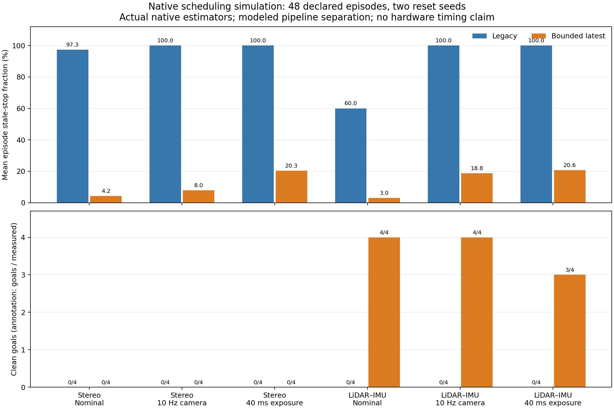

# Native processing schedules: completed simulation comparison

All **48/48 predeclared development episodes** completed, following a separate
**12/12-episode smoke** and a verified 40-pair input/transport profile. Native
FAST-LIO2 navigation reached **11/12 clean goals with the bounded latest-input
schedule versus 0/12 with the cumulative reference**. Native ORB-SLAM3 stereo
remained **0/12 in both schedules**, despite fewer stale-pose stops. All 48
episodes had **zero falls and contacts**.

These are descriptive simulation development results from two reset seeds.
The experiment uses actual native estimators but **models separation of
acquisition, inference and recording costs**; it does not measure a concurrent
physical robot pipeline. The simulated LiDAR has 16 rings and does not validate
the user's planar RPLIDAR C1.

## Outcomes

| Native estimator | Reference clean goals | Candidate clean goals | Reference stale decisions | Candidate stale decisions |
| --- | ---: | ---: | ---: | ---: |
| Stereo | 0/12 | 0/12 | 99.11% | 10.83% |
| LiDAR–IMU | 0/12 | 11/12 | 86.67% | 14.16% |

Stale fractions are means of episode fractions, measured over control decisions
at or after the fixed 10-second initialization. All episodes completed the
40-second horizon, so each has 750 navigation decisions. A lower stale fraction
does not guarantee a usable pose or motion: untracked/invalidated poses and
latency holds have separate behavior, and held commands can still be nonzero.
The combined paired stale-fraction change was **−80.39 percentage points** over
24 complete pairs, while the goal gain came entirely from LiDAR–IMU.

[SVG figure](../results/processing-schedule-20261012/groups.svg) ·
[All 24 paired outcomes](../results/processing-schedule-20261012/pairs.png) ·
[Group CSV](../results/processing-schedule-20261012/groups.csv) ·
[Pair CSV](../results/processing-schedule-20261012/pairs.csv).

The candidate LiDAR–IMU arm completed **4/4 nominal**, **4/4 at 10 Hz**, and
**3/4 with causal 40 ms exposure**. Its retained failure was the straight route,
seed 750001, with exposure: 48.13% stale decisions and no clean goal. None of
these failures or earlier negative campaigns was replaced or rerun.

The [independent trace audit](../results/processing-schedule-20261012/independent-trace-audit/audit.json)
explains the stereo limitation. The candidate issued nonzero commands on
**1,372/9,000** navigation decisions, versus **80/9,000** for the reference,
but all 12 candidate stereo episodes invalidated coordinate continuity. There
were 14 logical invalidation events and only five observed native map-ID changes;
these cannot all be described as confirmed SLAM resets. Its best distance to
the goal in any episode was **1.910 m**, outside the 0.30 m goal radius.
The 5,442 latency-hold decisions include 957 nonzero held commands, so they are
not all stops. Differing motion and sensor histories also prevent using these
invalidation counts as a standalone estimator-robustness ranking.

## Timing and experimental limits

For nominal stereo, the mean episode p95 of modeled delivery service changed
from **308.92 ms to 129.16 ms**. At 10 Hz it changed from **5,987.19 ms to
136.46 ms**, but actual native-client p95 changed from **47.33 ms to 53.88 ms**.
This is not faster ORB inference. Required PNG transport and native service
remain charged; simulated acquisition, evidence writes and recorder backpressure
are retained separately. Delivery-service p95 covers delivered responses;
native-client p95 covers all requests. Neither is complete physical sensor-to-
action latency. The unchanged capture-age gate is 350 ms.

Execution order alternated globally but was **fixed within each estimator**:
all 12 stereo pairs ran the reference first, while all 12 LiDAR–IMU pairs ran
the candidate first. Scheduling differences therefore remain confounded with
order-related warm-up/cache effects. The two seed clusters and fixed order do
not support an order-controlled causal estimate, population confidence interval,
or independent confirmation. Closed-loop images can diverge once actions differ.
[Frozen-protocol order audit](../results/processing-schedule-20261012/reporting/order-audit.json).

The comparison preserves the native settings, learned gait, routes, known-start
registration, initialization excitation, raw-LiDAR brake, coordinate-invalidity
stop behavior and simulated delivery quantization. Both estimator arms retain
the shared camera processing work. [Implementation and frozen design](PROCESSING_SCHEDULE_COMPARISON_2026-10-12.md).

## Verification and reproducibility

GPU job **21801949** ran the 27 declared stages on one Quadro RTX 8000:
input profile, fresh smoke, 24 matched pairs and strict collection. All four
pipeline/estimator smoke gates passed; **no declared cells remained unrun**.
Report job **21802046** independently checked compact evidence hashes,
trace-derived goals/safety/stale counts, queue conservation and delivery timing.
The plots and all eight report artifacts passed a separate review.

A second trace audit recomputed all 48 outcomes from **48,000 policy decisions**,
including **36,000 navigation decisions**, and checked **240 episode/raw
lineage hashes**, the declared cohort and collector agreement. Its
[script, log and complete per-seed breakdown](../results/processing-schedule-20261012/independent-trace-audit/)
are retained. Candidate LiDAR–IMU goals were 6/6 for seed 750000 and 5/6 for
seed 750001; both reference groups remained 0/6.

Frozen scientific source: `152ccf4d8a616c5725bfb0c44ac838818e028ee3`.
[Published source archive](https://github.com/joses2017smjh/bhl-robustness-ladder/releases/download/research-campaign-evidence-20261011/processing-schedule-20261012-source-46eb5d49361c.tar.gz),
SHA256 `46eb5d49361cb64f4f18dc8290a7bcb002c21b01aa035e3fe8c8e049949a0dda`.
The [evidence directory](../results/processing-schedule-20261012/) retains the
protocols, dispatch/collector receipts, numerical report, reporting code and
publication records. The automatically generated report is preserved verbatim;
this reviewed report adds the explicit order limitation above.

Publisher **21802129** completed without retry or overwrite. Independent audit
**21802627** rehashed all **27 original stage archives** (10,962,750,150 bytes),
checked all **431 compact-bundle members**, and matched **30 remote assets**
against fresh GitHub API identities, SHA256 digests and sizes.
[Public archive index](https://github.com/joses2017smjh/bhl-robustness-ladder/releases/download/research-campaign-evidence-20261011/processing-schedule-20261012-publication-index-fda7bd22348f.json) ·
[Compact numerical evidence](https://github.com/joses2017smjh/bhl-robustness-ladder/releases/download/research-campaign-evidence-20261011/processing-schedule-20261012-final-compact-c7c4eef23353.tar.gz) ·
[Independent publication audit](../results/processing-schedule-20261012/publication/independent-audit.json).
The retained campaign directory occupies **10.71 GiB** on shared storage; the
project had **515.73 GiB** of headroom below its 2 TiB hard limit at closeout.
[Storage receipt](../results/processing-schedule-20261012/storage.json).

Allocated validation passed **306 tests and 11 subtests**. The unchanged
scientific code also passed [GitHub CI](https://github.com/joses2017smjh/bhl-robustness-ladder/actions/runs/38296087794):
**3,108 tests**, 21 subtests, trained-asset integration and seeded physics replay.
The run records 132 skipped tests separately. No scientific source changed after
the freeze and fresh smoke.

## Supported résumé wording and remaining boundary

> Implemented a bounded sensor queue and asynchronous evidence recorder;
> evaluated native stereo and LiDAR–IMU navigation in 48 matched simulation
> episodes, observing 11/12 LiDAR–IMU clean goals versus 0/12 for the reference
> while retaining stereo failures, causal sensor timing and verifiable artifacts.

Keep the simulation qualifier and two-seed/order limitations with the supporting
report. This experiment does not establish stereo navigation success or hardware
speedup. Stereo coordinate recovery, an independently counterbalanced comparison
and physical calibration/validation remain separate research work.

The other requested task, [EuRoC native replay](EUROC_NATIVE_REPLAY_RESULTS_2026-10-12.md),
also completed without the robot: 1,200 original stereo pairs in each of stereo
and stereo–IMU, with independently verified tracking results. Pose accuracy on
that sequence remains unmeasured.
