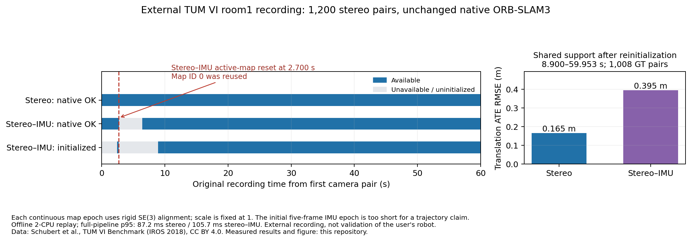

# Native stereo and stereo–IMU on an external real recording

**Completed: two native replays of 1,200 synchronized stereo pairs from TUM VI
room1.** Stereo maintained native tracking throughout this declared 60-second
prefix. Adding the IMU produced an active-map reset, lower initialized-pose
coverage, higher pose error on shared timestamps, and higher latency in this
single run. These are results on an **external recorded sensor dataset**, not
validation of the user's cameras, LiDAR, humanoid, or physical navigation.

## Measured results

| Measurement | Native stereo | Native stereo–IMU |
| --- | ---: | ---: |
| Camera pairs processed | 1,200 / 1,200 | 1,200 / 1,200 |
| Native `OK` tracking | 1,200 / 1,200 (100%) | 1,126 / 1,200 (93.83%) |
| Initialized, tracked poses | 1,200 / 1,200 (100%) | 1,027 / 1,200 (85.58%) |
| Tracking-loss transitions after `OK` | 0 | 1 |
| Observed native map-ID changes | 0 | 0; ID 0 was reused after reset |
| Continuous coordinate epochs | 1 | 2; one confirmed active-map reset |
| Native compute p95 | 55.26 ms | 70.03 ms |
| Full measured pipeline p95 | 87.19 ms | 105.68 ms |
| Full measured pipeline mean | 60.38 ms | 78.23 ms |

Stereo's continuous-prefix translation ATE RMSE was **0.15887 m** using
1,186 associated ground-truth poses. Ground-truth association uses distinct
nearest timestamps within 5 ms; 14 tracked frames had no association inside
that bound. Alignment is rigid SE(3), with scale fixed at 1.

For a comparison using the **same original timestamps after the IMU's second
initialization**, both methods had 1,022 accepted frames and 1,008 ground-truth
associations from 8.900 to 59.953 seconds. Stereo ATE RMSE was **0.16505 m**;
stereo–IMU ATE RMSE was **0.39526 m**. Each corresponding continuous epoch was
aligned independently. This is a descriptive comparison from one selected
recording window, not evidence of a general ranking across datasets.

The IMU first initialized at **2.450 s**, supplied only five initialized tracked
frames, and lost initialization when the active map reset at **2.700 s**. Its
native log attributes the reset to the bad-IMU/motion-initialization condition.
Visual tracking resumed at **6.400 s**, and IMU initialization resumed at
**8.900 s**. The initial five-frame epoch is insufficient evidence for a
long-trajectory accuracy claim. Its metrics are retained separately in the
machine-readable evaluation.

## Data, calibration and execution

The [official TUM VI dataset page](https://cvg.cit.tum.de/data/datasets/visual-inertial-dataset)
documents calibrated stereo/IMU recordings, synchronized clocks, and reference
poses in the IMU frame. It licenses the data under
[CC BY 4.0](https://creativecommons.org/licenses/by/4.0/).
Attribution: David Schubert, Thore Goll, Nikolaus Demmel, Vladyslav Usenko,
Jörg Stückler and Daniel Cremers, *The TUM VI Benchmark for Evaluating
Visual-Inertial Odometry*, IROS 2018.

The [protocol](../results/tumvi-external-validation-20261011/protocol.json)
was written at 10:13:02 UTC before native evaluation. It specified the first
60 seconds, at most 1,200 exact camera pairs, fixed 16-to-8-bit conversion,
the official calibration, and both native arms without tuning. The actual
last selected timestamp was 59.952679386 seconds. The 1,707,110,400-byte
official archive matched its publisher MD5; its SHA-256 is
`20354392eab5cc82c9770ed29cf0130c5acce0db54a257571499008fb34c398f`.

The separately downloaded official camera/IMU calibration was byte-identical
to the archive's calibration. The adapter uses OpenCV fisheye stereo
rectification and rotates the camera-to-IMU transform into the rectified
optical frame. Independent stereo and camera/IMU extrinsics must agree.
It converts intensity by the predeclared integer operation `uint16 >> 8`.
Observed original intensities spanned 176–65,520; no contrast or exposure
adjustment was fitted to outcomes.

The inertial arm acknowledged **11,956 original publisher-calibrated IMU rows**.
Integer nanosecond subtraction preserves the original clock before conversion
to seconds. Batches are disjoint and causal, with no synthetic, interpolated
or future IMU samples. Native ORB-SLAM3 initialization/feature thresholds and
the pinned runtime remained unchanged.

Execution used two allocated CPUs on `dgx2-1`, a private Ubuntu container home
and cache, and CPU-native ORB-SLAM3. The full measured pipeline includes PNG
reading, fixed intensity conversion, rectification, PNG writing, IMU TSV I/O,
client transport and native estimation. One-time process startup and calibration
map construction are excluded and reported separately. Both mean and p95
pipeline times exceed the 50 ms camera period: this was **offline replay**,
not demonstrated real-time 20 Hz operation. The arms ran sequentially in a
fixed order with no repeat trials, so latency differences are descriptive.

The dataset download and selected extraction stayed in node-local `/tmp`,
using about 2.8 GB including runtime/work files, below the 4 GiB budget.
No dataset images, IMU vectors or ground-truth CSV files were copied to home,
the shared filesystem, Git, or the release. The earlier
[EuRoC access attempt](EUROC_EXTERNAL_VALIDATION_2026-10-11.md) remains recorded
as blocked before evaluation; it was not silently substituted or counted as a
successful trial.

## Evaluation audit and reproducibility

The replay runner hashes the selected input files, including reference-file
bytes, for provenance. It never parses reference poses for inference, and the
native C++ estimator receives only rectified cameras, calibration and genuine
IMU measurements. A separate evaluator parses the calibrated IMU-frame truth
and verifies that the archive's independently labelled `gt_imu.csv` matches
its `mocap0` numeric rows.

The original evaluation source was frozen before anyone inspected performance
metrics. That first evaluator incorrectly treated a reused map ID as continuous
coordinates. The [preserved correction](../results/tumvi-external-validation-20261011/evaluator-correction-v2.json)
splits explicit map disappearance, initialization loss and reinitialization;
the superseded source and result remain available. **Use
[evaluation-v2.json](../results/tumvi-external-validation-20261011/evaluation-v2.json)
for pose metrics.** No native replay was repeated and no estimator setting was
changed. The paired, shared-timestamp analysis was added as a disclosed
descriptive follow-up to the reset discovery.

The [test receipt](../results/tumvi-external-validation-20261011/test-receipt.json)
records six adapter tests before replay, eight tests with the initial evaluator,
and ten final tests after adding reset regressions. Ten tests passed for clock
preservation, fixed intensity conversion, fisheye
geometry, camera/IMU transforms, causal genuine measurements, reference-frame
validation, and resets that reuse a map ID. An
[independent calculation](../results/tumvi-external-validation-20261011/independent-review.json)
using separate direct SVD alignment and nearest-timestamp code reproduced the
paired ATE values within `1e-12 m`. The complete native frame traces were
checked against the finished replay's hashes before evaluation.

The [compact derived evidence release](https://github.com/joses2017smjh/bhl-robustness-ladder/releases/download/research-campaign-evidence-20261011/tumvi-room1-native-derived-v2-20261011.tar.gz)
contains frozen code, native estimates/diagnostics, settings, frame-input
checksums and the corrected/superseded evaluations. It is 1,537,354 bytes,
SHA-256 `a53c8dd2f16163efc3bd4d251097fe86f3b0d07fc233764dbad65007a5a82079`,
and was freshly downloaded and verified after upload.
The [earlier verified asset](../results/tumvi-external-validation-20261011/superseded/publication-v1.json)
is preserved. The [presentation correction](../results/tumvi-external-validation-20261011/figure-correction-v2.json)
explicitly names the stereo–IMU reset and points its arrow at that arm's row;
the numerical results are unchanged.

A supported resume bullet, clearly labelled as external-recording work:

> Benchmarked native ORB-SLAM3 on 1,200 real recorded stereo pairs from TUM VI,
> achieving 100% visual tracking and 0.159 m rigid-aligned trajectory RMSE;
> audited IMU initialization resets and measured 87.2 ms p95 offline pipeline
> latency on two CPUs.

Broader external sequences, repeated runs, the user's own sensor calibration,
LiDAR validation and physical closed-loop navigation remain separate unfinished
validation tasks. This recording does not close them.
